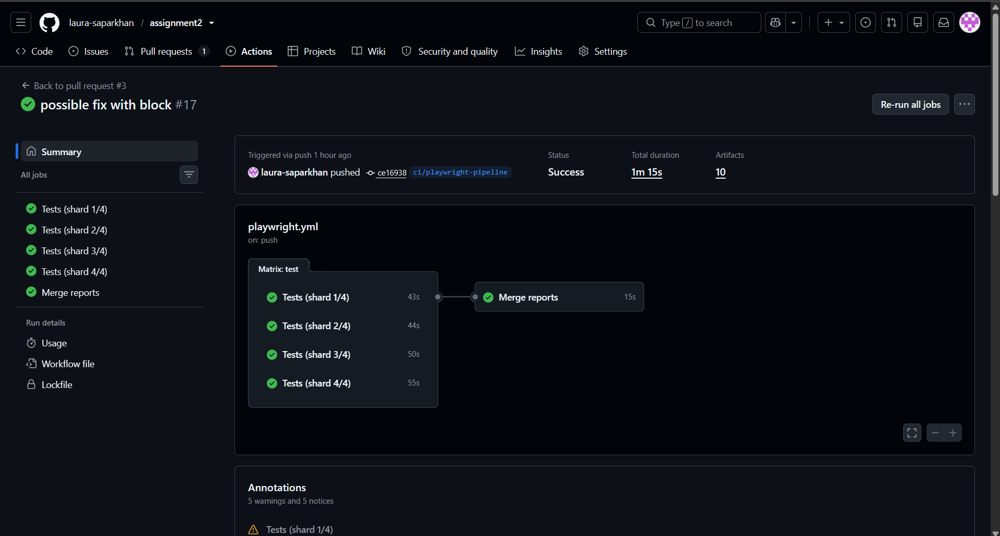
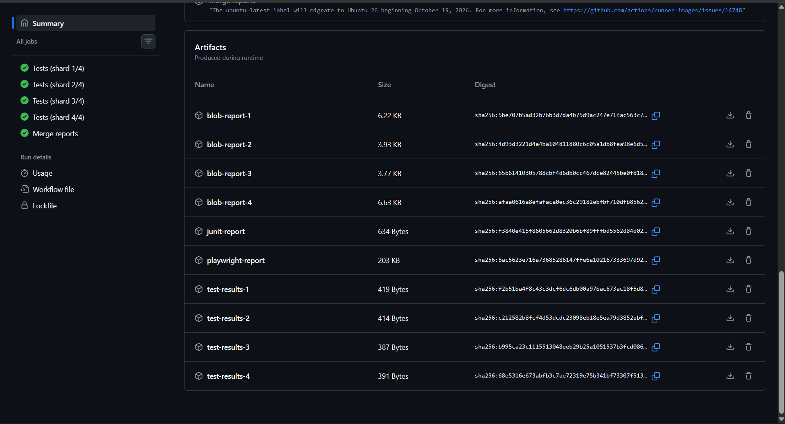
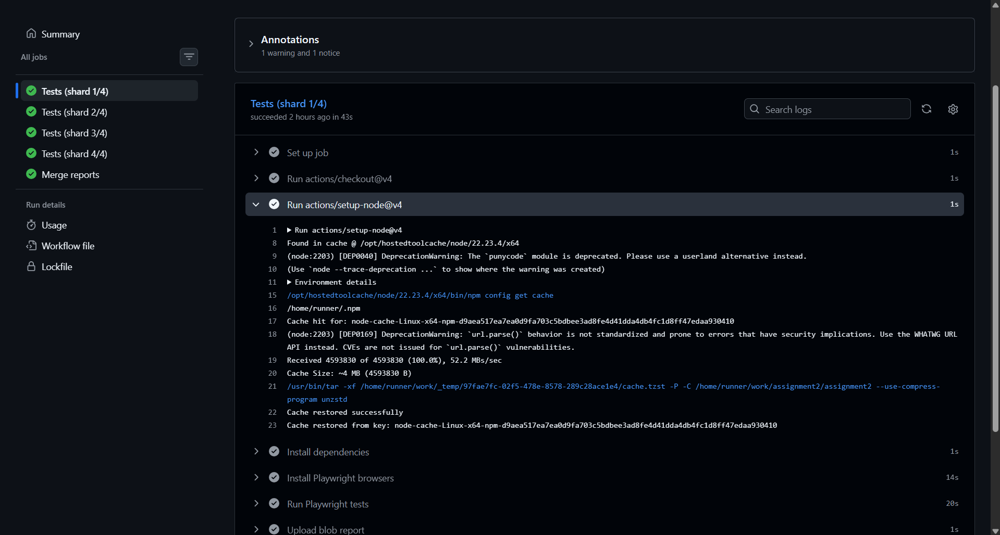
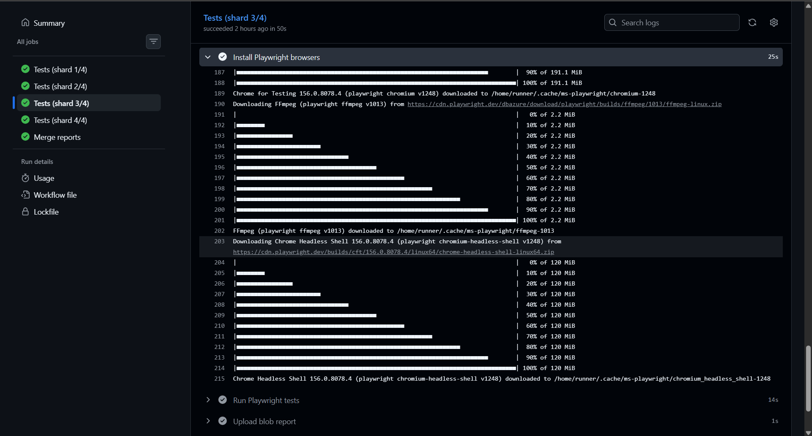
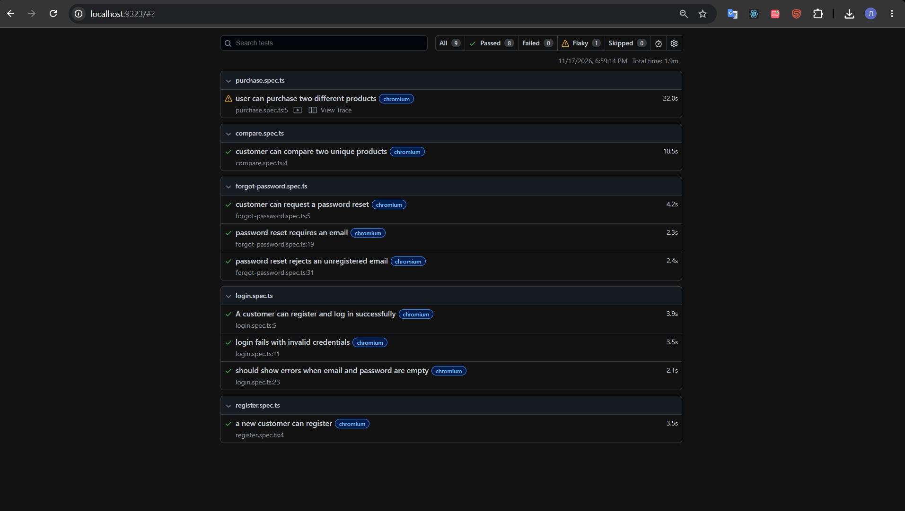
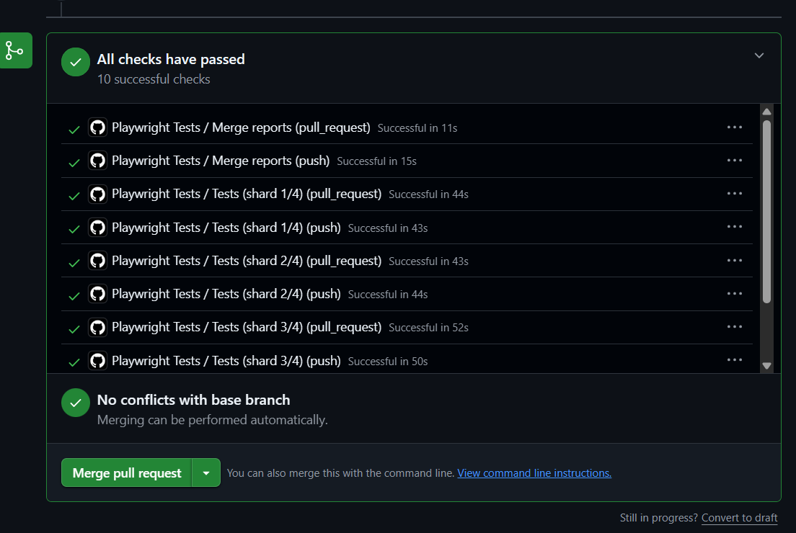
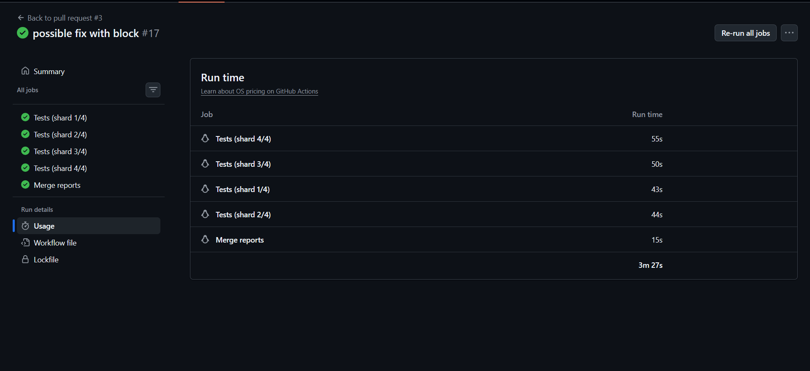
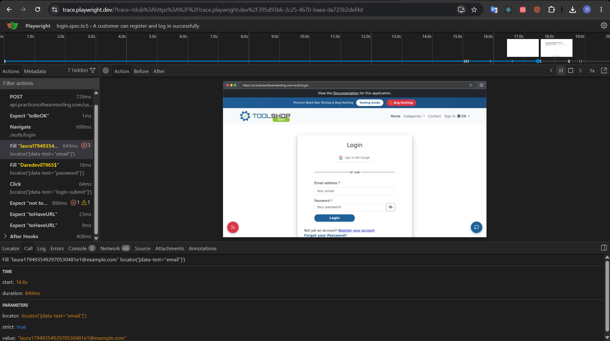
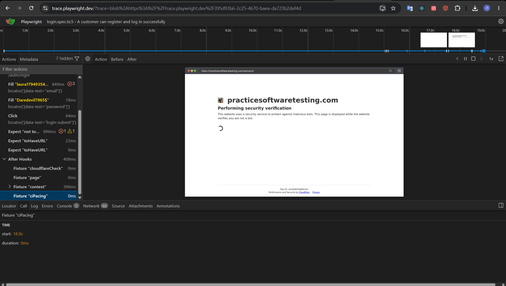

# Assignment 2 — Playwright test automation + CI pipeline

End-to-end UI tests for [Practice Software Testing](https://practicesoftwaretesting.com/),
written with Playwright Test and TypeScript using the Page Object Model.

The suite covers registration, login, password recovery, product comparison and a
full purchase flow (9 tests in 5 spec files). The project description is in
[docs/Description.md](docs/Description.md).

## CI

[](https://github.com/laura-saparkhan/assignment2/actions/workflows/playwright.yml)

**CI system:** GitHub Actions. It was chosen because it is built into GitHub, where
this repository already lives, so it needs no server of its own and no webhook
configuration. It is free for public repositories, and its build matrix provides
test sharding out of the box, which is exactly what the parallelism requirement
needs. GitLab CI and Jenkins would both require either moving the repository or
running and exposing a server locally for no added benefit here.

**Pipeline** (`.github/workflows/playwright.yml`):

- runs on **every push to every branch and on every pull request** (plus
  `workflow_dispatch` for manual timing runs);
- `actions/setup-node` with `cache: npm` caches `~/.npm` keyed on
  `package-lock.json`, then `npm ci` installs from the lock file;
- Chromium is installed with its system dependencies
  (`npx playwright install --with-deps chromium`);
- the **full** suite runs with no `--grep` / `--project` filter, split into
  **4 shards** (`--shard=i/4`) that run in parallel with `fail-fast: false`;
- the `merge-reports` job then merges the shards' blob reports into one HTML
  report and one combined JUnit file;
- `concurrency` cancels a superseded run when a new push lands on the same branch.

**Artefacts** (all kept for **14 days**, uploaded with `if: ${{ !cancelled() }}`
so they also exist when tests fail):

| Artefact | Contents |
| --- | --- |
| `playwright-report` | merged HTML report for all 4 shards |
| `test-results-1` … `test-results-4` | traces, screenshots, videos and the per-shard `reports/junit.xml` |
| `junit-report` | merged `reports/junit-merged.xml` |
| `blob-report-1` … `blob-report-4` | intermediate blob reports (1 day, consumed by the merge job) |

A trace is opened by downloading `test-results-N` and running
`npx playwright show-trace trace.zip`, or by dropping the file onto
[trace.playwright.dev](https://trace.playwright.dev).

**CI-specific configuration** (`playwright.config.ts`, active when `CI=true`):

| Setting | Value on CI | Why |
| --- | --- | --- |
| `forbidOnly` | `true` | a forgotten `test.only` fails the run instead of silently running one test and reporting green |
| `retries` | `2` | the suite runs against a live public site; an unstable test is marked *flaky* rather than red |
| `workers` | `1` | one browser per runner IP; the site's Cloudflare protection scores bursts of traffic from a single IP (see *Known issue* below) |
| `reporter` | `list`, `blob`, `junit` | readable logs, mergeable per-shard output, machine-readable XML |
| `trace` | `on-first-retry` | a trace of exactly the attempt that failed |
| `screenshot` / `video` | `only-on-failure` / `retain-on-failure` | failure evidence without bloating green runs |
| `fullyParallel` | `true` | `--shard` splits individual tests, not whole files, so no shard sits idle |

Locally the same config falls back to `retries: 0` and the familiar HTML reporter,
so nothing about the Assignment 1 workflow changes.

`baseURL` is read from the `BASE_URL` repository variable
(Settings → Secrets and variables → Actions → Variables) and falls back to
`https://practicesoftwaretesting.com`. No credentials are hardcoded: test accounts
are registered at runtime with generated unique e-mail addresses.

### Known issue: Cloudflare bot protection on CI runners

**In short:** the whole suite passes when it runs locally, but on GitHub Actions
some tests can fail even though nothing is wrong with the tests or the
application. The test site's Cloudflare protection deliberately blocks visits it
suspects are bots, and visits from GitHub's servers look like that to it. Instead
of the page, the browser gets a *"Verify you are human"* check (screenshot below),
so the test never reaches the page it needs and its assertions never get to run.
For example, *A customer can register and log in successfully* failed while
waiting for the e-mail field on the login page, so its final check, that the URL
contains `/account` after logging in, was never reached. A failure like this means
"the site refused to serve the CI runner", not "the feature is broken".


**In detail:** the application under test, `practicesoftwaretesting.com`, sits behind Cloudflare.
GitHub-hosted runners come from datacenter IP ranges that Cloudflare treats as
higher risk, so on CI the site sometimes answers a page load with a
**"Performing security verification — Verify you are human"** page instead of the
application. Locally, from a residential IP, this never happens — which is why the
suite was green on a laptop and red in Actions.

**How it was diagnosed.** The failing tests timed out waiting for
`[data-test="email"]`. The `test-failed-1.png` screenshot in the `test-results-N`
artefact showed the Cloudflare challenge page. Retries did not help: each retry
gets a fresh browser context from the same flagged IP.

**What the pattern showed.** In every failing run, each test's *first* page load
got through. The failures were always a *later* full page load in the same browser
session, made right after an account was registered. A challenge page can only be
returned for a full page load (a document request); clicks inside the Angular
single-page app are client-side routing and never fetch a new page. This fits how
Cloudflare's bot detection works: a script that runs during the first page load
checks the browser, and a later page load can then be challenged.

**Mitigation, first round:**

- 4 redundant `page.goto()` / `page.reload()` calls were removed, including a
  reload of the login page the test was already on. Two of them were replaced
  with clicks on the site's Home link, which a later trace showed also reloads the
  whole page, so those two changed nothing; the purchase test now uses the
  browser's Back button instead (see the second round below);
- `workers: 1` on CI, so each runner IP drives one browser at a time;
- on CI, a 3-second pause before each test and a 15-second pause before a retry,
  so a runner does not hit the site in rapid bursts (this adds about 3 seconds per
  test to the run time);
- an automatic fixture in `fixtures/pages.fixture.ts` checks every failed test for
  the challenge page and labels it `blocked-by-cloudflare` in the HTML report and
  the CI log, so such a failure is never mistaken for an application bug.

**Result of the first round.** Run #14, the first run with all of the above, still had 3 of 9 tests
blocked, all three labelled `blocked-by-cloudflare`. They were exactly the three
tests that register an account through the UI and then continue. The trace of one
of them shows why the mitigation could not cover them:

```
GET  practicesoftwaretesting.com/                    200   ← the test's single page load
POST api.practicesoftwaretesting.com/users/register  201   ← account created
GET  practicesoftwaretesting.com/auth/login          403   cf-mitigated: challenge
     (Referer: /auth/register)
```

After a successful registration, **the application itself** opens the login page
as a new page load, and a local trace shows it does the same after logging in
(`/auth/login` → `/account`). Those page loads come from the site's own code, so
the tests cannot avoid them while still registering and logging in through the UI.
For the same reason, `register.spec.ts` passed on CI only because it checks just
that the URL becomes `/auth/login`, which is true even when that page is the
challenge.

**Second round: test accounts through the API.** The blocked page loads were the
site's own reaction to the registration and login forms. So the tests that only
*need* an account now create it through the application's REST API
(`POST /users/register`, with the same request body the form sends), which the
trace showed is not challenged. Full page loads per test, counted from recorded
traces:

| Test | Account setup now | Full page loads before | after |
| --- | --- | --- | --- |
| `forgot-password.spec.ts`: request a password reset | API registration | 2 | 1 |
| `purchase.spec.ts` | API registration and API login; the token is placed in `localStorage` (`auth-token`) before the first page load | 6 | 1 |
| `login.spec.ts`: register and log in | API registration, then the login form | 3 | 2 |

No UI coverage was lost: the registration form is still tested end to end by
`register.spec.ts` and the login form by `login.spec.ts`. Only the *setup* of the
other tests moved to the API. With these changes `CI=true npx playwright test`
passes locally (9 of 9).

**Result of the second round.** On GitHub Actions, the next push run and
pull-request run (commit `ce16938`) were fully green: all 4 shards and the merge
job in both, 10 of 10 checks (screenshot 6 under *Evidence*). After the merge,
the first attempt of the push run on `main` (run #22) still failed and passed when
re-run; the six timing runs that followed (#25–#27, #29–#31) were all green on the
first attempt.

**What remains exposed.** Two tests still trigger the site's own page load after
a form, because the form is what they test: `register.spec.ts` (the site loads
`/auth/login` after registering) and the login test (the site loads `/account`
after logging in). Both end by checking the URL, and the URL is correct even when
Cloudflare serves its challenge at that address. So on CI these two checks can
pass without the page having rendered. A stronger check, such as the account
page's heading being visible, would make them fail whenever Cloudflare
intervenes. The Assignment 1 assertions were kept, and the limitation is
documented here instead. The trace in screenshot 9 under *Evidence* shows exactly
this case.

The mitigation reduces exposure but cannot guarantee it: whether Cloudflare
challenges a request is decided on its side. The only complete fix is to run the application
inside the pipeline — the project is open source and ships Docker Compose
([testsmith-io/practice-software-testing](https://github.com/testsmith-io/practice-software-testing)),
and `BASE_URL` already lets the suite target `http://localhost:4200` with no test
changes. Solving or bypassing the challenge was deliberately not attempted.

### Evidence

Screenshots 1–4 are from run #17: a push to `ci/playwright-pipeline`
(commit `ce16938`), the first run after the second round of Cloudflare changes.
It passed in 1 min 15 s.

**1. Four shards in parallel, then a merge job.** The `Matrix: test` box holds the
four shard jobs (43 s, 44 s, 50 s and 55 s), which run in parallel. `Merge reports`
(15 s) starts once all four have finished; it also runs when a shard fails
(`if: ${{ !cancelled() }}`), so a red run still gets a merged report.



**2. Artefacts, kept for 14 days.** `playwright-report` (merged HTML),
`test-results-1` … `test-results-4` (traces, screenshots, videos and per-shard
JUnit), `junit-report` (merged JUnit), and the intermediate `blob-report-1` …
`blob-report-4`. Every test passed on its first attempt, so the `test-results-N`
artefacts hold only the shard's JUnit file (about 400 bytes); traces, screenshots
and videos are saved only for retries and failures.



**3. npm cache restored.** The `setup-node` step of shard 1 reports
`Cache hit for: node-cache-Linux-x64-npm-…` and `Cache restored successfully`.



**4. Browser install and the full suite.** Each shard installs Chromium with its
system dependencies (shard 3 shown: Chrome for Testing, FFmpeg and Chrome Headless
Shell downloaded in 25 s), then runs `npx playwright test --shard=i/4` with no
`--grep` or `--project` filter.



**5. Merged report: all 9 tests in one report.** Taken from a **local** run with the
CI configuration, sharded and merged with `merge.config.ts` exactly as the
pipeline does, because the CI runs were affected by the Cloudflare block. All 9
tests from all shards appear in one report. `purchase` is marked flaky: it failed
once with a server error from the demo site and passed on retry, and its trace is
attached (*View Trace*).



**6. A run for a push and a run for a pull request, both green.** After the second
round of Cloudflare changes (commit `ce16938`), the push to `ci/playwright-pipeline`
and the pull request each ran the 4 shards and the merge job, and all 10 checks
passed.



**7. Run time per job.** The *Usage* page of run #17 lists each job's run time:
shard 4 took 55 s, shard 3 50 s, shard 2 44 s, shard 1 43 s, and `Merge reports` 15 s.
Together they add up to 3 min 27 s of runner time, while the run itself took
1 min 15 s from start to finish because the four shards ran at the same time. This
is the trade-off of sharding: less waiting, but more runner minutes, since every
shard repeats the same setup (checkout, `npm ci`, browser install).



**8. A CI trace opened in trace.playwright.dev.** From the `test-results` artefact
of run #22's first attempt: the retry of the login test
(`login.spec.ts:5`), recorded because of `trace: 'on-first-retry'`. The left panel
lists every action with its duration (the API registration `POST`, `Navigate`
to `/auth/login`, the two `Fill`s, `Click` and the `Expect`s), the strip at the
top is the timeline, and the centre shows the page as it was at the selected
action: here, the login form just before the e-mail is typed.



**9. The same trace, after the login click.** Selecting the last step shows what
the browser actually received at `/account`: the Cloudflare "Performing security
verification" page instead of the account page. The URL checks after the click
still completed, which is the weakness described under *What remains exposed*.



### Runtime

| Configuration | Total run time | Run tests step (slowest shard) | Run |
| --- | --- | --- | --- |
| 1 job, no sharding | 2 min 24 s | 1 min 10 s | [run #29](https://github.com/laura-saparkhan/assignment2/actions/runs/44141352744) |
| 4 shards + merge | 1 min 22 s | 22 s | [run #25](https://github.com/laura-saparkhan/assignment2/actions/runs/44136881332) |

Median of 3 runs triggered via `workflow_dispatch`, all green on the first attempt:

| Configuration | Run | Total run time | Run tests step (slowest shard) |
| --- | --- | --- | --- |
| 1 job | [#29](https://github.com/laura-saparkhan/assignment2/actions/runs/44141352744) | 2 min 24 s | 1 min 5 s |
| 1 job | [#30](https://github.com/laura-saparkhan/assignment2/actions/runs/44142063034) | 2 min 29 s | 1 min 13 s |
| 1 job | [#31](https://github.com/laura-saparkhan/assignment2/actions/runs/44142774190) | 1 min 58 s | 1 min 10 s |
| 4 shards | [#25](https://github.com/laura-saparkhan/assignment2/actions/runs/44136881332) | 1 min 22 s | 21 s |
| 4 shards | [#26](https://github.com/laura-saparkhan/assignment2/actions/runs/44137194183) | 1 min 8 s | 25 s |
| 4 shards | [#27](https://github.com/laura-saparkhan/assignment2/actions/runs/44137667257) | 1 min 25 s | 22 s |

The single-job runs were made on a temporary branch, `ci/timing-1shard`, whose
only change is the matrix (`shardIndex: [1]`, `shardTotal: [1]`); the merge job
still runs there, so both rows include it.

**Conclusion:** splitting the suite into 4 shards cut the run from 2 min 24 s to
1 min 22 s (about 43 % faster) and the test step from 1 min 10 s to 22 s, but not
by 4×, because every shard repeats the same ~30 s of setup (checkout, `npm ci`,
browser install). For the same reason sharding costs more runner time in total,
about 3 min 10 s per run against about 2 min 20 s for a single job (median sum of
all job times).

### Running locally

```bash
npm ci
npx playwright install --with-deps chromium

# normal local run (HTML report, no retries)
npx playwright test
npx playwright show-report

# exactly what CI does, on one machine
CI=true npx playwright test          # PowerShell: $env:CI="true"; npx playwright test
```

Reproducing the sharding and the report merge locally (the blob reporter clears its
folder before each run, so each shard's archive is copied aside first):

```bash
mkdir -p all-blob-reports
CI=true npx playwright test --shard=1/2 && cp blob-report/*.zip all-blob-reports/
CI=true npx playwright test --shard=2/2 && cp blob-report/*.zip all-blob-reports/
npx playwright merge-reports --config merge.config.ts ./all-blob-reports
npx playwright show-report
```

The workflow file itself can be executed locally with
[act](https://github.com/nektos/act) and Docker:

```bash
act push -P ubuntu-latest=catthehacker/ubuntu:act-latest \
         --artifact-server-path ./.act-artifacts
```

### Repository layout

```
.github/workflows/playwright.yml   CI pipeline (4 shards + merge job)
playwright.config.ts               test config, with the CI branch
merge.config.ts                    config used by `playwright merge-reports`
tests/                             spec files and test helpers
pages/                             Page Objects
fixtures/pages.fixture.ts          fixture that injects the Page Objects
docs/                              assignment documentation and AI usage log
```
