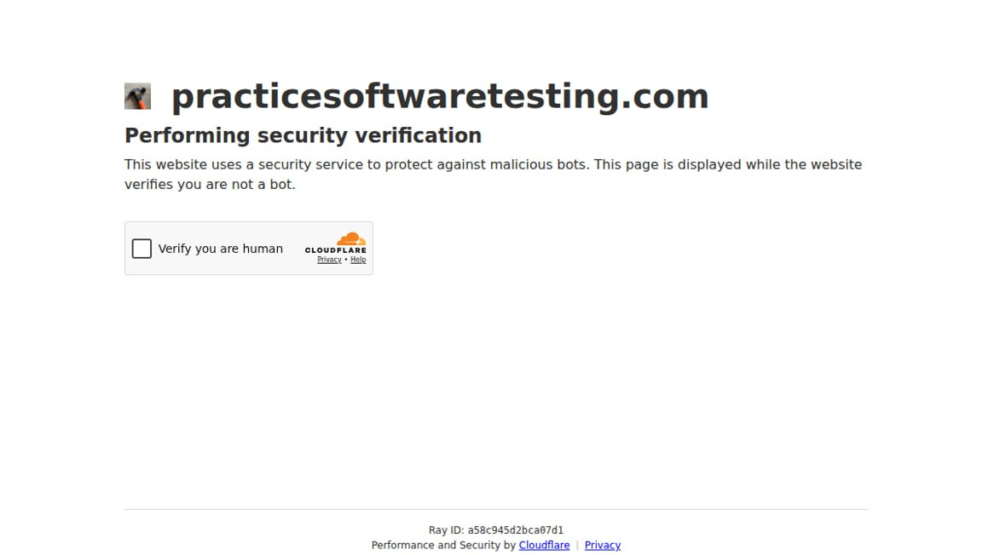

# Assignment 2 — Playwright test automation + CI pipeline

End-to-end UI tests for [Practice Software Testing](https://practicesoftwaretesting.com/),
written with Playwright Test and TypeScript using the Page Object Model.

The suite covers registration, login, password recovery, product comparison and a
full purchase flow (9 tests in 5 spec files). The project description is in
[docs/Description.md](docs/Description.md).

## CI

[](https://github.com/laura-saparkhan/assignment2/actions/workflows/playwright.yml)

**CI system:** GitHub Actions. It was chosen because it is built into GitHub, where
this repository already lives, so it needs no server of its own and no webhook
configuration. It is free for public repositories, and its build matrix provides
test sharding out of the box, which is exactly what the parallelism requirement
needs. GitLab CI and Jenkins would both require either moving the repository or
running and exposing a server locally for no added benefit here.

**Pipeline** (`.github/workflows/playwright.yml`):

- runs on **every push to every branch and on every pull request** (plus
  `workflow_dispatch` for manual timing runs);
- `actions/setup-node` with `cache: npm` caches `~/.npm` keyed on
  `package-lock.json`, then `npm ci` installs from the lock file;
- Chromium is installed with its system dependencies
  (`npx playwright install --with-deps chromium`);
- the **full** suite runs with no `--grep` / `--project` filter, split into
  **4 shards** (`--shard=i/4`) that run in parallel with `fail-fast: false`;
- the `merge-reports` job then merges the shards' blob reports into one HTML
  report and one combined JUnit file;
- `concurrency` cancels a superseded run when a new push lands on the same branch.

**Artefacts** (all kept for **14 days**, uploaded with `if: ${{ !cancelled() }}`
so they also exist when tests fail):

| Artefact | Contents |
| --- | --- |
| `playwright-report` | merged HTML report for all 4 shards |
| `test-results-1` … `test-results-4` | traces, screenshots, videos and the per-shard `reports/junit.xml` |
| `junit-report` | merged `reports/junit-merged.xml` |
| `blob-report-1` … `blob-report-4` | intermediate blob reports (1 day, consumed by the merge job) |

A trace is opened by downloading `test-results-N` and running
`npx playwright show-trace trace.zip`, or by dropping the file onto
[trace.playwright.dev](https://trace.playwright.dev).

**CI-specific configuration** (`playwright.config.ts`, active when `CI=true`):

| Setting | Value on CI | Why |
| --- | --- | --- |
| `forbidOnly` | `true` | a forgotten `test.only` fails the run instead of silently running one test and reporting green |
| `retries` | `2` | the suite runs against a live public site; an unstable test is marked *flaky* rather than red |
| `workers` | `1` | one browser per runner IP; the site's Cloudflare protection scores bursts of traffic from a single IP (see *Known issue* below) |
| `reporter` | `list`, `blob`, `junit` | readable logs, mergeable per-shard output, machine-readable XML |
| `trace` | `on-first-retry` | a trace of exactly the attempt that failed |
| `screenshot` / `video` | `only-on-failure` / `retain-on-failure` | failure evidence without bloating green runs |
| `fullyParallel` | `true` | `--shard` splits individual tests, not whole files, so no shard sits idle |

Locally the same config falls back to `retries: 0` and the familiar HTML reporter,
so nothing about the Assignment 1 workflow changes.

`baseURL` is read from the `BASE_URL` repository variable
(Settings → Secrets and variables → Actions → Variables) and falls back to
`https://practicesoftwaretesting.com`. No credentials are hardcoded: test accounts
are registered at runtime with generated unique e-mail addresses.

### Known issue: Cloudflare bot protection on CI runners

**In short:** the whole suite passes when it runs locally, but on GitHub Actions
some tests can fail even though nothing is wrong with the tests or the
application. The test site's Cloudflare protection deliberately blocks visits it
suspects are bots, and visits from GitHub's servers look like that to it. Instead
of the page, the browser gets a *"Verify you are human"* check (screenshot below),
so the test never reaches the page it needs and its assertions never get to run.
For example, *A customer can register and log in successfully* failed while
waiting for the e-mail field on the login page, so its final check, that the URL
contains `/account` after logging in, was never reached. A failure like this means
"the site refused to serve the CI runner", not "the feature is broken".



**In detail:** the application under test, `practicesoftwaretesting.com`, sits behind Cloudflare.
GitHub-hosted runners come from datacenter IP ranges that Cloudflare treats as
higher risk, so on CI the site sometimes answers a page load with a
**"Performing security verification — Verify you are human"** page instead of the
application. Locally, from a residential IP, this never happens — which is why the
suite was green on a laptop and red in Actions.

**How it was diagnosed.** The failing tests timed out waiting for
`[data-test="email"]`. The `test-failed-1.png` screenshot in the `test-results-N`
artefact showed the Cloudflare challenge page. Retries did not help: each retry
gets a fresh browser context from the same flagged IP.

**What the pattern showed.** In the failing run, every test's *first* page load got
through (9 of 9). Both failures happened on a *second* full page load made right
after registering an account. A challenge page can only be returned for a full
document request; clicks inside the Angular single-page app are client-side
routing and never fetch a new document.

**Mitigation in this repository:**

- every test performs exactly **one** full page load; all later navigation uses
  the app's own links (home, cart, sign-in), as a real user would. This removed 4
  redundant `page.goto()` / `page.reload()` calls, including a reload of the login
  page the test was already on;
- `workers: 1` on CI, so each runner IP drives one browser at a time;
- on CI, a 3-second pause before each test and a 15-second pause before a retry,
  so a runner does not hit the site in rapid bursts (this adds about 3 seconds per
  test to the run time);
- an automatic fixture in `fixtures/pages.fixture.ts` checks every failed test for
  the challenge page and labels it `blocked-by-cloudflare` in the HTML report and
  the CI log, so such a failure is never mistaken for an application bug.

This reduces exposure but cannot guarantee it: whether Cloudflare challenges a
request is decided on its side. The only complete fix is to run the application
inside the pipeline — the project is open source and ships Docker Compose
([testsmith-io/practice-software-testing](https://github.com/testsmith-io/practice-software-testing)),
and `BASE_URL` already lets the suite target `http://localhost:4200` with no test
changes. Solving or bypassing the challenge was deliberately not attempted.

### Runtime

| Configuration | Total run time | Run tests step (slowest shard) | Run |
| --- | --- | --- | --- |
| 1 job, no sharding | _X min Y s_ | _X min Y s_ | [run](LINK) |
| 4 shards + merge | _X min Y s_ | _X min Y s_ | [run](LINK) |

Median of 3 runs triggered via `workflow_dispatch`.

**Conclusion:** _to be written from the measured numbers._

### Running locally

```bash
npm ci
npx playwright install --with-deps chromium

# normal local run (HTML report, no retries)
npx playwright test
npx playwright show-report

# exactly what CI does, on one machine
CI=true npx playwright test          # PowerShell: $env:CI="true"; npx playwright test
```

Reproducing the sharding and the report merge locally (the blob reporter clears its
folder before each run, so each shard's archive is copied aside first):

```bash
mkdir -p all-blob-reports
CI=true npx playwright test --shard=1/2 && cp blob-report/*.zip all-blob-reports/
CI=true npx playwright test --shard=2/2 && cp blob-report/*.zip all-blob-reports/
npx playwright merge-reports --config merge.config.ts ./all-blob-reports
npx playwright show-report
```

The workflow file itself can be executed locally with
[act](https://github.com/nektos/act) and Docker:

```bash
act push -P ubuntu-latest=catthehacker/ubuntu:act-latest \
         --artifact-server-path ./.act-artifacts
```

### Repository layout

```
.github/workflows/playwright.yml   CI pipeline (4 shards + merge job)
playwright.config.ts               test config, with the CI branch
merge.config.ts                    config used by `playwright merge-reports`
tests/                             spec files and test helpers
pages/                             Page Objects
fixtures/pages.fixture.ts          fixture that injects the Page Objects
docs/                              assignment documentation and AI usage log
```
